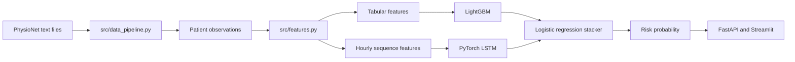
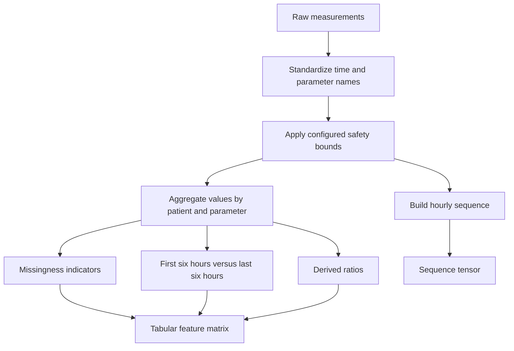
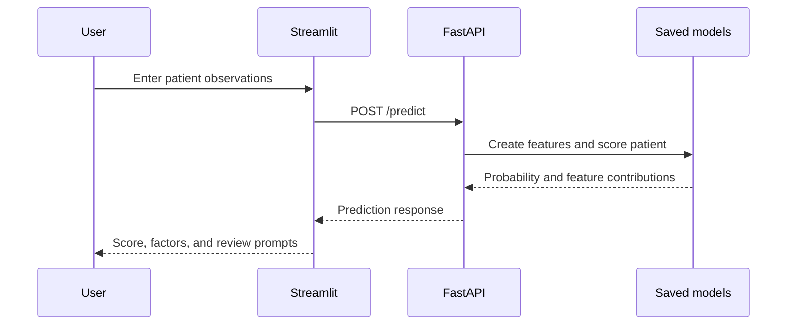

# Early ICU Mortality Prediction

This project uses the first 48 hours of ICU measurements to estimate the chance of
in-hospital mortality. I built it as a learning project using the PhysioNet/CinC
Challenge 2012 dataset.

It is not a clinical tool and should not be used to make treatment decisions.

## Why I built it

The question I wanted to explore was:

> Can early vital signs and laboratory measurements provide a useful estimate of
> in-hospital mortality risk?

The repository covers the full workflow:

- reading the original PhysioNet text files
- cleaning and aggregating measurements from the first 48 hours
- handling missing clinical values
- training tabular and sequence models
- evaluating the models on held-out data
- serving risk estimates and important features through a small web application

### Project flow

The main path looks like this:



## Dataset

The project uses the PhysioNet/CinC Challenge 2012 dataset. The data contains ICU
stays with measurements such as heart rate, blood pressure, temperature, Glasgow Coma
Scale, blood tests, and urine output.

The repository expects the data to be arranged like this:

```text
data/raw/
|-- set-a/
|-- set-b/
`-- set-c/
```

Each set directory should contain its unzipped patient files. The matching outcome
files should be placed directly under `data/raw/`:

```text
data/raw/
|-- Outcomes-a.txt
|-- Outcomes-b.txt
|-- Outcomes-c.txt
|-- set-a/
|-- set-b/
`-- set-c/
```

The data is not included in this repository.

The main training script uses labeled Set A. Set B can be processed for unlabeled
risk scoring by `src/test_set_b.py`, while Set C is evaluated separately by
`src/test_set_c.py`.

## How it works

### 1. Prepare the data

`src/data_pipeline.py` reads the raw text files and turns them into a long-format table
of patient observations. The compiled data is cached as Parquet, so later runs can
skip the raw-file parsing step when the source files have not changed.

### 2. Create features

`src/features.py` creates patient-level features from the observations. These include:

- mean, minimum, maximum, standard deviation, and count for each measurement
- first and last recorded values
- indicators for measurements that were never recorded
- changes between the first six hours and the last six hours
- a small number of derived clinical ratios, such as shock index and P/F ratio

Values outside the configured clinical bounds are treated as invalid before the
aggregations are calculated. Missing values are not automatically replaced with zero.

The feature-building steps can be summarized as follows:



### 3. Train the models

The main training path combines two model types:

- LightGBM for the patient-level tabular features
- a PyTorch bidirectional LSTM for the hourly sequence features

The two model outputs are combined with a logistic-regression stacker. This lets the
project use the strengths of both a tabular model and a time-series model instead of
choosing only one of them.

### 4. Evaluate the predictions

The dataset has an imbalanced outcome: about **13.8%** of ICU admissions result in in-hospital death (baseline mortality). Because positive cases are a minority, AUROC alone can look deceptively high; we also evaluate AUPRC (Precision-Recall AUC), the PhysioNet Challenge Event 1 score, and Brier calibration loss.

Here are the real evaluation scores from our trained hybrid ensemble:

| Metric | 5-Fold Cross-Validation (Set A) | 15% Held-Out Test Set | Unseen Set C Cohort (4,000 Patients) | What it Means in Plain Language |
|:---|:---:|:---:|:---:|:---|
| **AUROC** | 0.8680 ± 0.012 | **0.8604** | **0.8591** | **86% discriminative ability** to rank higher-risk patients above lower-risk patients. |
| **AUPRC** | 0.5558 ± 0.044 | **0.5400** | **0.5469** | Nearly **4x higher precision** than a random baseline (0.138) across all recall levels. |
| **PhysioNet Event 1** | 0.5310 ± 0.035 | **0.5301** | **0.5256** | The official challenge score balancing sensitivity and positive predictive value. |
| **Brier Score** | 0.0862 ± 0.005 | **0.0856** | **0.0919** | Low mean squared error (close to 0.0), showing well-calibrated probabilities. |

### How to Understand the Risk Scores (In Plain Human Language)

When the model estimates a patient's risk:
- **ICU Baseline Mortality is 13.8%**: In a typical ICU population, roughly 14 out of 100 patients do not survive.
- **Optimal Decision Cutoff is 31.1%**: Based on the PhysioNet Challenge optimization, any probability above 31% is more than double the ICU average and flags high mortality risk.
- **Risk Tiers**:
  - **Low Risk (< 15%)**: At or below normal ICU baseline. Common in alert patients (GCS 15) recovering from routine procedures.
  - **Moderate Risk (15% - 31%)**: Above baseline; requires close monitoring.
  - **High Risk (31% - 50%)**: Above the optimal clinical decision cutoff; indicates significant physiological strain.
  - **Critical High Risk (> 50%)**: Severe organ dysfunction, shock, or deep coma (GCS < 8, severe acidosis, or kidney failure).

### Real Model Outputs Across Clinical Profiles

| Patient Profile | Vitals & Labs Recorded | LightGBM | PyTorch LSTM | Final Ensemble | Risk Status |
|:---|:---|:---:|:---:|:---:|:---:|
| **Stable Recovery** | Age 55, HR 72, BP 120/80, GCS 15, Temp 37.0, BUN 16, Creat 0.9 | 4.3% | 7.8% | **4.7%** | 🟢 Low Risk |
| **Isolated Vital Spike** | Age 78, HR 200, BP 200/130, GCS 15, Temp 37.2 (No organ failure labs) | 5.5% | 12.2% | **5.3%** | 🟢 Low Risk *(With tachycardia warning)* |
| **Neurological Trauma** | Age 78, HR 200, BP 200, **GCS 8** (Significant neurological depression) | 21.6% | 27.6% | **12.3%** | 🟡 Moderate Risk |
| **Septic Shock** | Age 75, HR 140, BP 75/40, **GCS 6**, Temp 39.5, **BUN 85, Creat 4.0, Lactate 6** | 67.7% | 79.5% | **68.8%** | 🔴 Critical High Risk |
| **Severe Coma & Organ Failure** | Age 80, HR 115, BP 85/50, **GCS 3**, BUN 95, Creat 5.0, Lactate 8 | 71.2% | 97.1% | **77.1%** | 🔴 Critical High Risk |

> **Important Clinical Context**: Why does an isolated vital spike with GCS 15 score low risk? In the 48-hour PhysioNet ICU cohort, **53% of patients had GCS = 15**, and their mortality rate was only **5.9%**. Conscious, alert patients in an ICU rarely die from brief vital swings unless accompanied by acute organ failure (elevated BUN, creatinine, or lactic acidosis). When organ failure is present, the model escalates immediately to critical risk.

## Repository layout

```text
icu-mortality-prediction/
|-- api/
|   `-- main.py                 # FastAPI endpoints for prediction and ranking
|-- app/
|   `-- streamlit_ui.py         # Small interface for entering observations
|-- data/
|   |-- raw/                    # Local PhysioNet files, not committed
|   `-- processed/              # Cached data and evaluation outputs
|-- src/
|   |-- data_pipeline.py       # Read and combine raw observations
|   |-- features.py             # Build tabular and sequence features
|   |-- model_dl.py             # PyTorch LSTM model and training loop
|   |-- evaluate.py             # Cross-validation and metrics
|   |-- explain.py              # Feature contribution helpers
|   |-- train.py                # Train using one cohort
|   |-- train_combined.py       # Train using Sets A and B
|   |-- tune_lgbm.py            # Optional LightGBM tuning
|   |-- test_set_b.py           # Evaluate on Set B
|   |-- test_set_c.py           # Evaluate on Set C
|   `-- utils.py                # Logging, random seeds, and artifacts
|-- config.py                   # Paths and model settings
|-- requirements.txt            # Python dependencies
`-- README.md
```

## Technology used

- Python
- Pandas and NumPy for data preparation
- scikit-learn for splitting, metrics, calibration, and stacking
- LightGBM for tabular classification
- PyTorch for the LSTM model
- SHAP for tree-model feature contributions
- FastAPI and Uvicorn for the prediction API
- Streamlit and Plotly for the interface

This project does not use LangChain or a language model. The inputs are structured
clinical measurements.

## Setup and running

From the repository folder, create a virtual environment and install the dependencies:

```powershell
cd icu-mortality-prediction
python -m venv .venv
.\.venv\Scripts\Activate.ps1
pip install -r requirements.txt
```

Run the unit tests to verify the installation:

```powershell
python -m pytest tests/ -v
```

or, if pytest is not installed:

```powershell
python -m unittest discover -s tests -v
```

Place the PhysioNet files under `data/raw/set-a`, `data/raw/set-b`, and
`data/raw/set-c` before training or evaluation.

### Train the model

Train on Set A:

```powershell
python -m src.train
```

The optional combined training script is:

```powershell
python -m src.train_combined
```

After training, the model bundle is saved as
`models/hybrid_ensemble_core.joblib`.

### Evaluate Set C

```powershell
python -m src.test_set_c
```

### Start the API

Open one terminal in the repository folder and run:

```powershell
uvicorn api.main:app --port 8000
```

The API is available at `http://127.0.0.1:8000`. Interactive documentation is at
`http://127.0.0.1:8000/docs`.

### Start the dashboard

In a second terminal, activate the same environment and run:

```powershell
.\.venv\Scripts\Activate.ps1
streamlit run app/streamlit_ui.py
```

The dashboard uses the API running on port `8000`, so keep both terminals open.

## API examples

### Predict one patient

`POST /predict`

```json
{
  "Age": 72,
  "Gender": 1,
  "Observations": [
    {"Parameter": "HR", "Value": 118},
    {"Parameter": "GCS", "Value": 8},
    {"Parameter": "SysABP", "Value": 82},
    {"Parameter": "Temp", "Value": 38.9}
  ]
}
```

Example response (100% computed from models):

```json
{
  "Mortality_Risk_Probability": 0.3842,
  "LGBM_Probability": 0.3615,
  "LSTM_Probability": 0.4280,
  "Clinical_Status_Flag": "HIGH RISK",
  "PhysioNet_Optimal_Cutoff": 0.3112,
  "Review_Suggestions": [
    "High mortality risk detected (exceeds PhysioNet Challenge Event 1 threshold of 31%). Intensive monitoring advised.",
    "Low GCS recorded: assess airway protection status and consider neurological evaluation.",
    "Hypotension detected: evaluate fluid responsiveness and vasopressor requirements."
  ],
  "Primary_Risk_Drivers": {
    "escalating": [
      {"feature": "Glasgow Coma Scale (GCS) Last", "impact": 0.284},
      {"feature": "Systolic Blood Pressure (Invasive) Min", "impact": 0.089}
    ],
    "mitigating": [
      {"feature": "Blood Urea Nitrogen (BUN) Mean", "impact": -0.045}
    ]
  }
}
```

### Rank several patients

`POST /rank` accepts a list of records and sorts them by predicted probability:

```json
[
  {
    "Patient_ID": "demo-001",
    "Patient": {
      "Age": 72,
      "Gender": 1,
      "Observations": [
        {"Parameter": "HR", "Value": 118},
        {"Parameter": "GCS", "Value": 8},
        {"Parameter": "SysABP", "Value": 82}
      ]
    }
  }
]
```

Other endpoints:

- `GET /health` checks whether the API is running.
- `GET /docs` opens the automatically generated FastAPI documentation.

The application flow is intentionally small: the user enters a few observations,
the API creates the same feature layout expected by the trained model, and the UI
shows the score, feature contributions, and review prompts.



## Limitations

- The dataset is historical and is not a current hospital population.
- A single API request contains one value per measurement, so it does not represent a
  complete 48-hour patient time series.
- The ranking endpoint only orders model scores; it does not decide who should receive
  care first.
- The review prompts are simple threshold rules, not clinical guidelines.
- The project does not include prospective hospital validation, fairness analysis across
  clinical subgroups, monitoring, authentication, or clinical workflow integration.
- The model output is not calibrated or validated for use in a real hospital.

## Reproducibility

The project sets a random seed in `config.py` and passes it to the main data-splitting
and cross-validation steps. LightGBM is generally repeatable with the same data and
settings. The PyTorch model can vary slightly between runs because of CPU numerical
operations.

Training and evaluation details are written to `logs/Pipeline_execution.log` when the
pipeline is run.

## Possible next steps

- Add API validation tests once the serving dependencies are installed.
- Compare the neural network with a simpler logistic-regression baseline.
- Add subgroup performance checks by age, sex, and ICU type.
- Add calibration plots and threshold analysis.
- Containerize the API only after the model workflow is stable.

## License and data

Check the repository files for the project license. The PhysioNet dataset has its own
terms of use and should be downloaded from the original source rather than committed
to this repository.